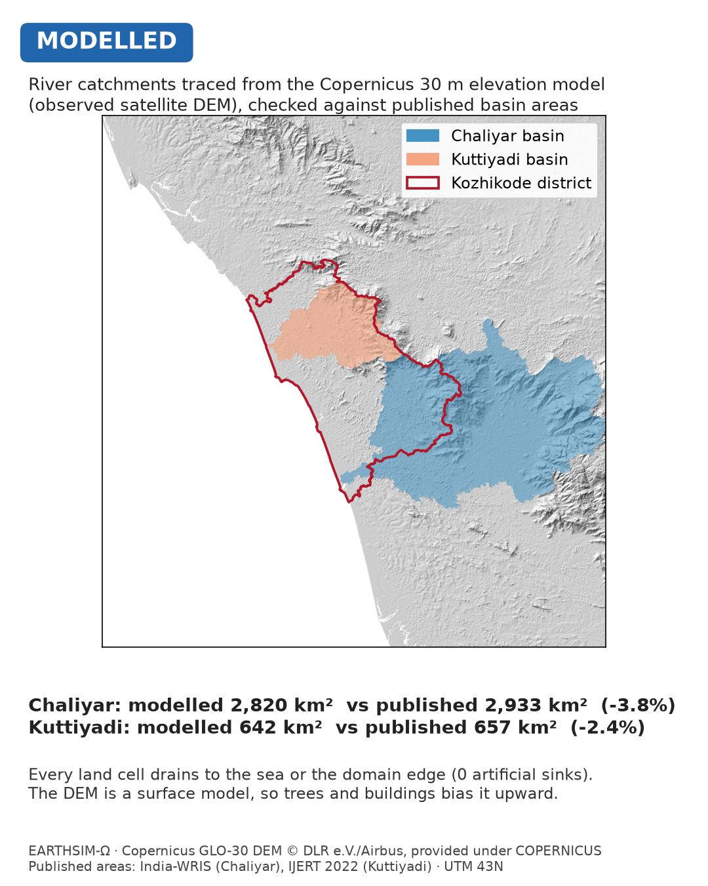
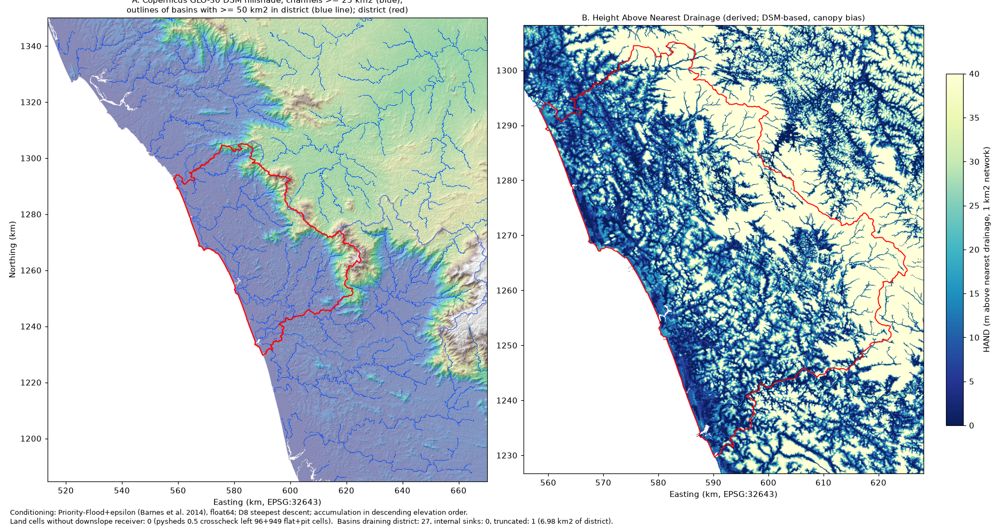
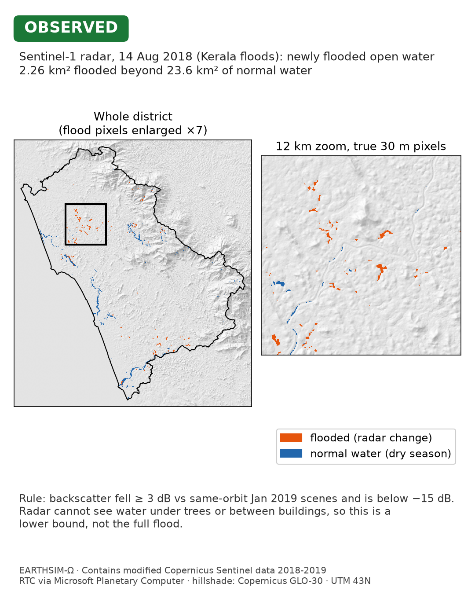
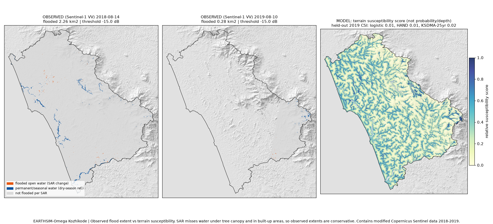
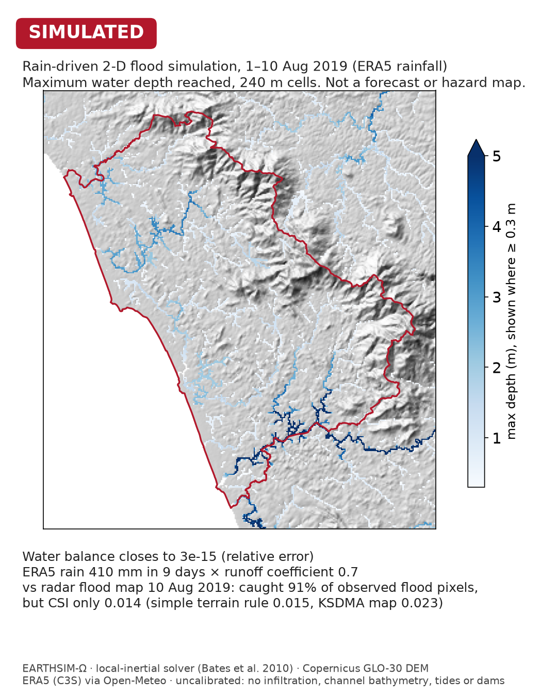
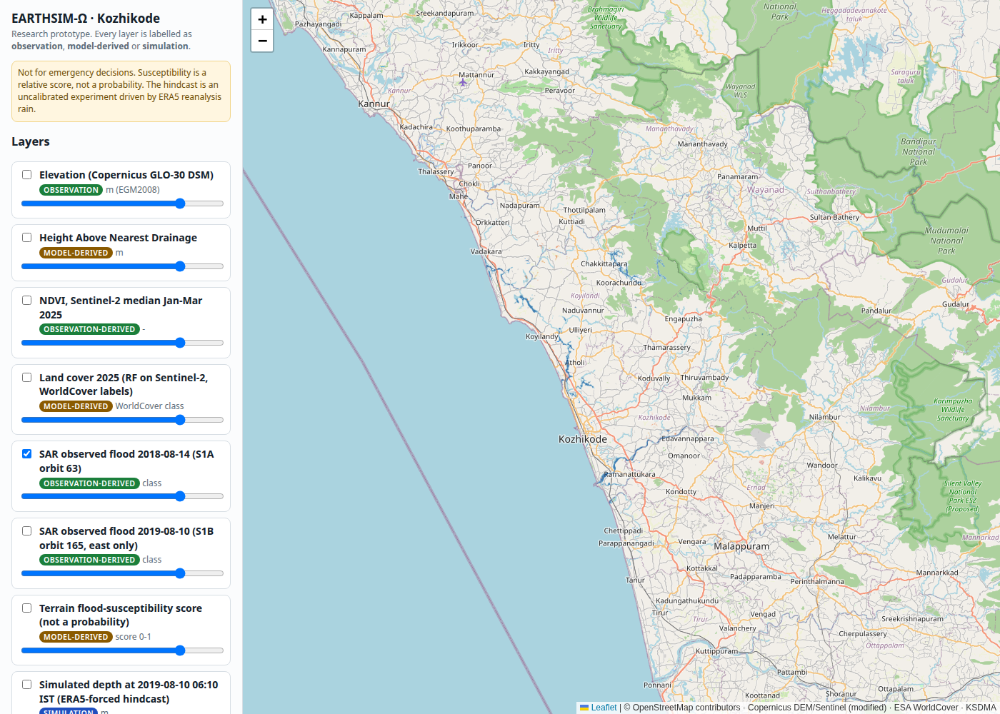
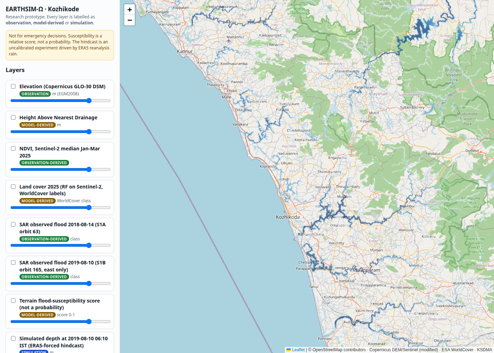
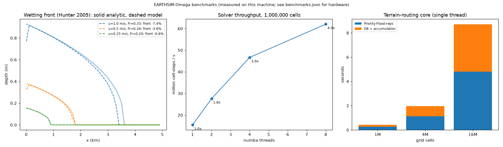

# EARTHSIM-Ω: Kozhikode geospatial digital-twin prototype

EARTHSIM-Ω is a research prototype that builds a working, evidence-backed geospatial "digital twin" of
Kozhikode district, Kerala. It covers terrain and hydrology, Sentinel-2 indices, land cover, Sentinel-1
flood observation, a baseline flood-susceptibility workflow, a 2-D hydraulic solver with a regional hindcast,
and an API with a web map. Every result is computed from real public data with recorded provenance.

**Status.** This is a first working release, not a finished platform. Read
[`docs/REPORT.md`](docs/REPORT.md) for the status of each feature and the supporting evidence. It is
**not for emergency or operational decisions.**

## Results at a glance

Each image is labelled by what it shows. **OBSERVED** is a satellite measurement, **MODELLED** comes from an
algorithm or statistical model, and **SIMULATED** is output of the flood solver driven by reanalysis rain.
Numbers come from [`docs/REPORT.md`](docs/REPORT.md) and the JSON files in `experiments/results/`.

### Terrain and catchments (MODELLED)



The basins were delineated from the 30 m Copernicus DEM. They match published basin areas closely: Chaliyar is
2,820 km² against 2,933 km² on India-WRIS (−3.8%), and Kuttiyadi is 642 km² against 657 km² (−2.4%).



The full terrain model covers conditioned elevation, flow accumulation, the channel network and height above
nearest drainage (HAND). No land cell is left without a downstream receiver.

### Observed flooding, 14 August 2018 (OBSERVED)



This is Sentinel-1 radar (RTC, VV) compared with dry-season scenes from the same orbit. It shows 2.26 km² of newly
flooded land beyond 23.6 km² of normal water. The pass came before the 14–16 August rain peak, and radar cannot
see water under trees or between buildings, so this is a lower bound.

### Observed flooding vs susceptibility maps (OBSERVED + MODELLED)



Every method catches most observed flood pixels (recall 0.81–0.97) but scores a very low CSI (0.008–0.023). That
includes the official KSDMA 25-year hazard map, which scores best (CSI 0.023 on the 2019 test). A simple terrain
rule (HAND ≤ 0.5 m, CSI 0.015) beats the logistic model (CSI 0.008).

### August 2019 flood hindcast (SIMULATED)



This is the maximum depth from the 2-D local-inertial solver, driven by ERA5 rain and run uncalibrated. Mass
closes to about 1e-15. Against radar on 2019-08-10 it scores CSI 0.014 with recall 0.91. That does not beat the
HAND rule or the KSDMA map on the same pixels.

### Web map (served from the API)





These are Leaflet screenshots of `earthsim serve`. The first shows the observed 2018 radar flood layer and the
second the simulated 2019 maximum depth.

### Solver scaling (measured on this machine)



Solver throughput on 1 M cells rises from 15.5 M cell-steps/s on 1 thread to 62.1 M on 8 threads (4.0×, with
4 physical cores plus SMT). These are medians of 3 runs on an 8-vCPU machine with no GPU.

## Install (tested on Ubuntu 24.04, Python 3.12, CPU only)

```bash
cd earthsim-omega
python3 -m venv .venv && source .venv/bin/activate      # or: uv venv .venv && source .venv/bin/activate
pip install -e ".[all]"                                  # pinned; exact env in requirements-lock.txt
earthsim doctor                                          # hardware/software report + recommended profile
python -m pytest -q                                      # offline test suite (synthetic fixtures only)
```

No paid API keys are needed. All data comes from open endpoints: AWS Open Data (Copernicus DEM, ESA
WorldCover), Earth Search (Sentinel-2 L2A), Microsoft Planetary Computer (Sentinel-1 RTC, anonymous
signing via the `planetary-computer` package), Open-Meteo (ERA5), Overpass (OSM) and geoBoundaries.

## Run the pipeline

```bash
earthsim data list                          # manifest + local availability
earthsim data download <dataset_id>         # e.g. copernicus_dem_glo30, sentinel2_l2a_2025q1, sentinel1_rtc_floods
earthsim data validate <dataset_id>         # CRS/extent/nodata/checksum checks
earthsim run terrain                        # DEM conditioning, D8, accumulation, streams, HAND, basins
earthsim run s2_indices                     # cloud-masked median composite + NDVI/NDWI/MNDWI/NDBI/NDMI
earthsim run landcover                      # RF vs baselines with 5 km spatial-block CV
earthsim run flood_obs                      # Sentinel-1 change-detection flood extents
earthsim run flood_susceptibility           # baseline susceptibility, leakage-safe evaluation
earthsim run hindcast --tag base            # Aug-2019 rain-on-grid hindcast (about 3.5 min on 8 vCPUs)
earthsim run hindcast_eval                  # score hindcast runs vs SAR 2019-08-10
earthsim run benchmarks                     # solver correctness + scaling (run on an idle machine)
earthsim serve                              # API + web map at http://127.0.0.1:8000
```

Configuration lives in `configs/default.yaml` and is validated with pydantic. Override any value with
`--set section.key=value` (e.g. `--set compute.workers=2`) or `EARTHSIM_<SECTION>__<KEY>` environment
variables. Experiment configurations used for the reported results are in `configs/experiments/`.

## Layout

```
src/earthsim/      package: config, hardware, provenance, geo, catalog, remote_sensing, hydro_core,
                   hydrology, landcover, sar, floodsus, hydraulics, scenario, benchmarks, viz, api, cli
configs/           default.yaml, datasets.yaml (dataset manifest), experiments/*.yaml
tests/             unit tests + synthetic fixtures (no network)
web/               Leaflet web map served by the API
data/raw/          acquired data + _acquisition.json (checksums, URLs, times)   [not in git]
data/processed/    stage outputs + provenance.json per stage                    [not in git]
experiments/       evaluation records;  benchmarks/results/  measured benchmarks
figures/           figures rendered from real outputs;  docs/  documentation
```

## Troubleshooting

| Symptom | Cause / fix |
|---|---|
| `invalid configuration: ...` | A config value failed validation. The message names the field and the allowed range. |
| Overpass returns 406 or disconnects | It needs an identifying User-Agent (set in the adapter). Retry later or use the mirror listed in `datasets.yaml`. |
| Sentinel-1 download is very slow | The full-resolution RTC COGs are read over HTTP. The adapter reads overview level 0 (20 m). Use `--set compute.workers=2` on slow links. |
| `numpy has no attribute in1d` from pysheds | Shimmed in `earthsim.hydrology`. Routing uses the in-house numba Priority-Flood core, and pysheds is only a cross-check. |
| Benchmarks look slow | Something else is using the CPU. Run them alone. Numbers are machine-specific (see `benchmarks/results/benchmarks.json`). |
| Web map shows "not produced yet" | Run the stage that produces that layer. The API only serves real outputs. |
| Restarted server shows old jobs as failed | Intended. Jobs interrupted by a restart are marked failed, not left as "running". |

## Licences

The code is provided for research use. Data licences are in [`docs/DATA_SOURCES.md`](docs/DATA_SOURCES.md):
Copernicus data are free with attribution, ESA WorldCover is CC BY 4.0, OSM and geoBoundaries are ODbL, ERA5
requires Copernicus attribution, and the KSDMA rasters are third-party with unclear licence (local use only).
