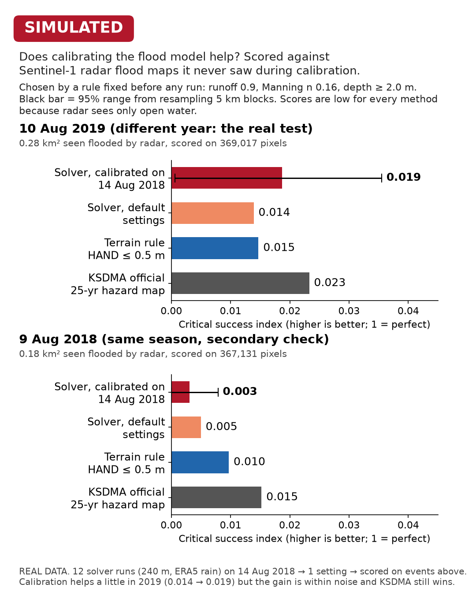

# Calibrating the flood model, and testing it on a year it never saw

**Short answer:** calibration makes the solver a little better on the held-out 2019 flood (CSI 0.014 → 0.019). The gain sits inside the noise, though, and the official KSDMA hazard map (0.023) still scores best. On a second 2018 date the calibrated model did worse than every baseline. I report this as it came out.



## The rule was fixed before any run

The protocol is in [`configs/experiments/flood_calibration.yaml`](../configs/experiments/flood_calibration.yaml). It was committed to git before the first calibration run started (commit message "Pre-register flood calibration protocol").

- **Model:** the 240 m local-inertial rain-on-grid solver (see METHODOLOGY.md), driven by ERA5 hourly rain.
- **Parameters searched:** runoff coefficient C ∈ {0.3, 0.5, 0.7, 0.9} × land Manning's n ∈ {0.04, 0.08, 0.16}, which gives 12 runs. Each run is also scored at 9 depth thresholds (0.05–2.0 m) for calling a cell "flooded".
- **Calibration event:** Sentinel-1 flood map of **14 Aug 2018**. It covers the full district: 2,604,564 reference pixels, of which 2.26 km² were newly flooded.
- **Selection rule:** the highest CSI on the calibration event. Ties go to the smallest |log frequency bias|.
- **Test events, never used for selection:** **10 Aug 2019**, a different year and the real test (369,017 pixels, 0.28 km² flooded), and **9 Aug 2018**, a secondary check from the same season (367,131 pixels, 0.18 km² flooded).
- **Uncertainty:** 1,000 bootstrap resamples of 5 km spatial blocks, which keeps neighbouring pixels together.
- **Baselines on identical pixels:** the uncalibrated default (C 0.7, n 0.08, 0.3 m), HAND ≤ 0.5 m, the KSDMA 25-year hazard footprint, and "all dry".

Each run simulates from 1 Aug 2018 00:00 IST up to the 14 Aug overpass and takes 10–13 minutes on 2 threads. The three waves of 4 parallel runs took 37 minutes in total. The relative mass error stayed below 2e-14 in every run.

## What the calibration found

| Runoff C | n = 0.04 | n = 0.08 | n = 0.16 |
|---|---|---|---|
| 0.3 | 0.0149 | 0.0159 | 0.0158 |
| 0.5 | 0.0160 | 0.0159 | 0.0162 |
| 0.7 | 0.0145 | 0.0164 | 0.0171 |
| 0.9 | 0.0169 | 0.0167 | **0.0195** |

*Best CSI on 14 Aug 2018 for each parameter pair, at its best depth threshold.*

- **Chosen:** C 0.9, n 0.16, depth ≥ 2.0 m. That gives CSI 0.0195, hit rate 0.20 and false-alarm ratio 0.98 (20.9 km² predicted against 2.26 km² observed).
- **The surface is almost flat.** The 12 parameter pairs span only 0.0145–0.0195. Most of the gain comes from raising the depth threshold, which shrinks the predicted area. For the chosen run, CSI rises steadily from 0.004 at 0.05 m to 0.0195 at 2.0 m. This is equifinality: very different settings fit the one radar map almost equally well.
- **All three chosen values sit at the edge of the grid.** A wider grid might score higher. I did not extend it, because that would be tuning after seeing results.
- **The selection is unstable in space.** Split the district into two checkerboard halves of 5 km blocks. Selecting on half A picks (0.7, 0.08, 1.0 m), which scores 0.021 on half B. Selecting on half B picks (0.9, 0.16, 2.0 m), which scores only 0.008 on half A.

## Held-out results

| Method | 10 Aug 2019 CSI | Hit rate | False-alarm ratio | 9 Aug 2018 CSI |
|---|---|---|---|---|
| **Solver, calibrated** | **0.019** (95%: 0.001–0.036) | 0.87 | 0.98 | 0.003 (95%: 0.000–0.008) |
| Solver, default settings | 0.014 | 0.91 | 0.99 | 0.005 |
| HAND ≤ 0.5 m | 0.015 | 0.95 | 0.99 | 0.010 |
| KSDMA 25-yr hazard map | **0.023** | 0.95 | 0.98 | **0.015** |
| All dry | 0 | 0 | — | 0 |

What this means:

1. On the real test year, calibration improves the solver from 0.014 to 0.019 and moves it just past the HAND rule. The bootstrap interval (0.001–0.036) overlaps both, so the improvement is **not statistically resolved**.
2. The KSDMA official map is still the best footprint on both test dates.
3. On 9 Aug 2018 the calibrated model is the worst method. The 2.0 m threshold, chosen for the 14 Aug peak, is too strict for an earlier, smaller flood.
4. Every score is low. The radar sees only open water in the open, at one moment, so it misses water under trees, between buildings and at the true peak. A low CSI here is mostly a statement about the reference.

## How this feeds the decision-support cycle

The forecast cycle uses the calibrated setting (C 0.9, n 0.16, 2.0 m) for its flood scenarios. Because the flood model's skill is unresolved, **the alert level is set by the verified rain triggers, not by the flood model** (see [EARLY_WARNING.md](EARLY_WARNING.md)).

## Reproduce

```bash
earthsim calibrate terrain                                          # cache the 240 m terrain and exposure index
for c in 0.3 0.5 0.7 0.9; do for n in 0.04 0.08 0.16; do echo "$c $n"; done; done |
  xargs -P 4 -n 2 sh -c 'NUMBA_NUM_THREADS=2 python -m earthsim.calibration simulate --season 2018 --c $0 --n $1'
earthsim calibrate select                                           # applies the pre-registered rule
earthsim calibrate test                                             # 2019 + 2018-08-09 held-out scoring
python scripts/phone_figures.py calibration                         # the figure above
```

The results are in `experiments/results/calibration_selection.json` and `experiments/results/calibration_test.json`.
