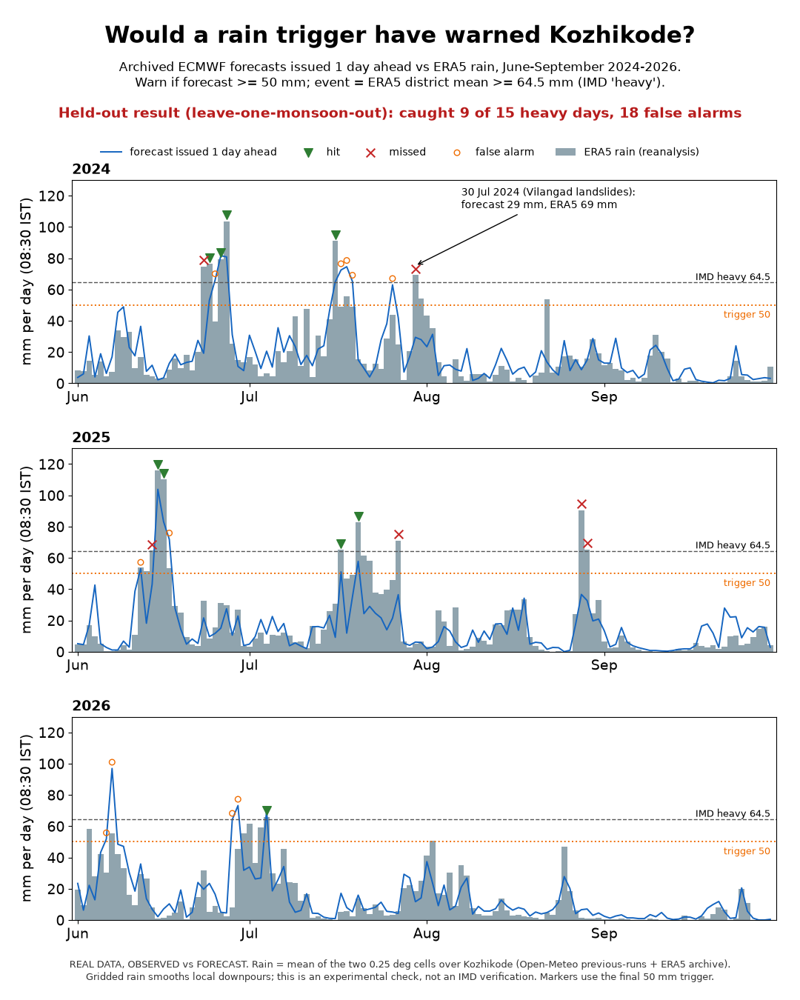

# Experimental flood decision support for Kozhikode

**This is a research prototype, not an official warning service.** Rain warnings for Kerala come from the India Meteorological Department (IMD), river forecasts from the Central Water Commission (CWC), and orders and evacuations from the Kerala State Disaster Management Authority (KSDMA) and the Kozhikode District Disaster Management Authority. Every output of this module says so on its face.

## What one cycle does

`earthsim forecast run` (or `GET /api/forecast/latest` once a cycle has run) does five things, all from live public data:

1. **Fetches the rain forecast.** It pulls the ECMWF IFS 0.25° deterministic forecast (with the last five days, which are used as antecedent rain) and the 51-member ECMWF ensemble from [Open-Meteo](https://open-meteo.com/). It also fetches the model-run metadata, so every cycle records which ECMWF run it used. The raw responses are stored with their URLs and SHA-256 hashes.
2. **Builds a rain outlook.** For each IMD-style day (24 h to 08:30 IST) it gives the deterministic total, the ensemble 10th/50th/90th percentiles, and the share of ensemble members reaching IMD heavy (≥64.5 mm), very heavy (≥115.6 mm) and extremely heavy (≥204.5 mm) rain. The thresholds come from the IMD terminology in the [IMD Pune hazard atlas](https://imdpune.gov.in/hazardatlas/extreme.pdf). Rain is the mean of the two 0.25° cells over the district.
3. **Runs the flood model.** It runs the calibrated rain-on-grid model (see [CALIBRATION.md](CALIBRATION.md)) for four scenarios: the deterministic forecast, plus the ensemble members closest to the 10th, 50th and 90th percentile of 72-hour rain. Runs start five days back so that soils and channels already hold the recent rain. Snapshots are taken at +24, +48 and +72 h.
4. **Counts exposure.** It counts what sits in simulated wet cells (depth at or above the calibrated threshold): OSM buildings (240,990 in the extract), schools and hospitals (out of 3,520 mapped facilities) and major-road kilometres.
5. **Writes the outputs.** It sets an experimental level (GREEN / YELLOW / ORANGE / RED) and writes `alert.json`, `bulletin.md`, `outlook.png` and `manifest.json` (inputs, hashes, code version, timings, status). The `latest` pointer moves only when the whole cycle succeeds, so a failed cycle never replaces a good one.

## How the level is set

The level comes from the rain triggers. The flood model supplies the *where* and *what is exposed*, but its skill has only been checked on two events, so it does not set the level on its own.

| Level | Rule (any day in the next 72 h) | Verified? |
|---|---|---|
| RED | ≥50% of members very heavy, or ≥20% extremely heavy | No (no archived ensemble) |
| ORANGE | ≥50% of members heavy, or ≥20% very heavy | No |
| YELLOW | ≥20% of members heavy, or deterministic forecast ≥ 50 mm | The 50 mm trigger is verified below |
| GREEN | none of the above | — |

## How good is the rain trigger?

Archived ECMWF forecasts by lead time are available from Open-Meteo's previous-runs archive from 2024 onward (2021–2023 return no data). I compared them with ERA5 for every June–September day in 2024, 2025 and 2026. That is 366 days, of which 15 had ERA5 district-mean rain at or above 64.5 mm.

**Using the IMD threshold directly on the forecast** (warn if forecast ≥ 64.5 mm):

| Forecast issued | Hit rate | False-alarm ratio | CSI | Correlation |
|---|---|---|---|---|
| same day | 0.40 | 0.50 | 0.29 | 0.81 |
| 1 day ahead | 0.40 | 0.54 | 0.27 | 0.80 |
| 2 days ahead | 0.33 | 0.58 | 0.23 | 0.73 |
| 3 days ahead | 0.53 | 0.50 | 0.35 | 0.71 |
| 5 days ahead | 0.27 | 0.56 | 0.20 | 0.68 |

**Tuning a lower trigger, scored honestly.** In leave-one-monsoon-out cross-validation, the trigger is chosen on two monsoons and scored on the third. Pooled over the three held-out monsoons:

| Forecast issued | Triggers chosen per fold | Hit rate | False-alarm ratio | CSI | False alarms per non-event day |
|---|---|---|---|---|---|
| 1 day ahead | 35 / 50 / 50 mm | **0.60** (9 of 15) | 0.67 (18 false alarms) | 0.27 | 0.051 |
| 2 days ahead | 30 / 70 / 50 mm | 0.47 | 0.77 | 0.18 | 0.068 |
| 3 days ahead | 50 / 65 / 50 mm | 0.60 | 0.57 | 0.33 | 0.034 |

A lower trigger catches more heavy days but brings more false alarms; CSI barely moves. The chosen trigger jumps between folds, which shows how few events there are. Fifteen events is too few to separate lead times reliably: the 3-day score being higher than the 1-day score is noise, not a real effect. The deployed trigger is 50 mm, the best on all three monsoons together.

**The 30 July 2024 case.** On the night of 29–30 July 2024 the [Vilangad landslides](https://www.thehindu.com/news/national/kerala/a-year-after-vilangad-landslip-scars-remain/article69874181.ece) hit Kozhikode, the same night as the Wayanad disaster. The forecast issued one day ahead gave 29 mm for the district. ERA5 later showed 69 mm, and the same-day forecast 94 mm. A 50 mm trigger would have missed it at one day's lead. Gridded rain also smooths the local downpours that cause landslides, so even ERA5's 69 mm understates what fell on the worst-hit slopes.



## Limits to keep in mind

- **Truth is ERA5, not rain gauges.** ERA5 is a reanalysis at about 25 km, so heavy days at single stations are more frequent than heavy days in the grid mean. IMD station data was not used.
- **Season.** Verification covers June–September only. Skill in the October–December north-east monsoon is unknown, and the bulletin says so.
- **Ensemble probabilities are unverified.** Open-Meteo does not archive past ensembles at these lead times, so the ORANGE and RED cut-offs are reasoned choices, not tested ones.
- **The flood footprint is a scenario.** Its skill against radar is in [CALIBRATION.md](CALIBRATION.md). It is checked on two events, and radar misses water under trees and among buildings.
- **Exposure counts are not damage.** They count OSM features in wet 240 m cells. OSM coverage is incomplete, and a building in a wet cell is not necessarily flooded inside.

## Running it on a schedule

`scripts/forecast_scheduler.py` polls Open-Meteo's ECMWF ensemble metadata (`last_run_initialisation_time`) every 10 minutes. When a new model run appears, it runs one cycle under an exclusive file lock, so cycles never overlap. Failures are retried up to three times per model run, and old run folders are pruned (60 kept by default). Every decision goes to `logs/forecast_scheduler.log`. ECMWF runs every 6 hours; on 22 October 2026 the 06 UTC ensemble appeared on Open-Meteo about 10 hours after initialisation.

```bash
python scripts/forecast_scheduler.py --once        # one check, run if there is a new model run
nohup python scripts/forecast_scheduler.py &       # keep polling
# or cron: */10 * * * * cd /path/to/earthsim-omega && .venv/bin/python scripts/forecast_scheduler.py --once
```
