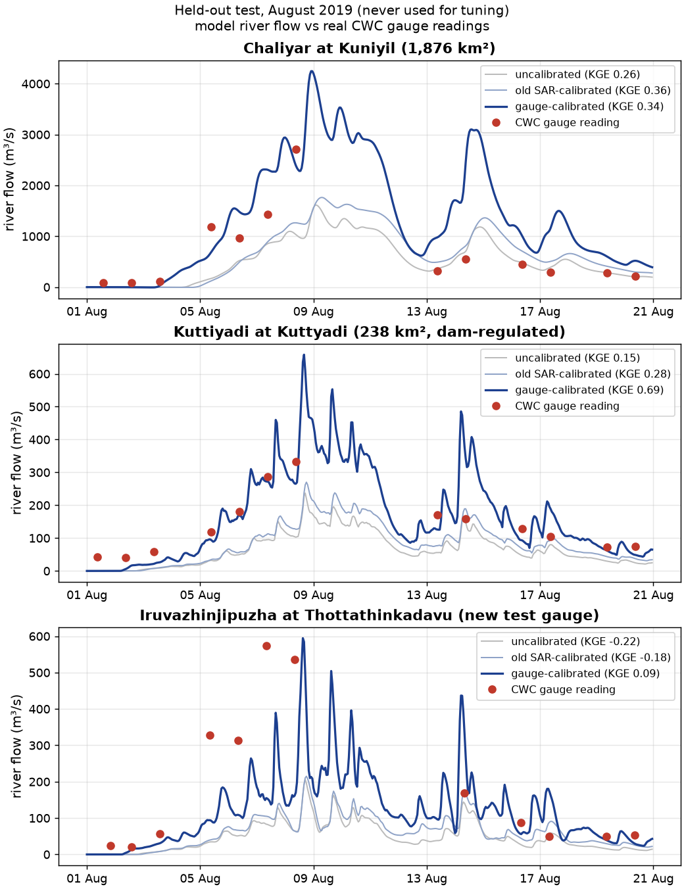
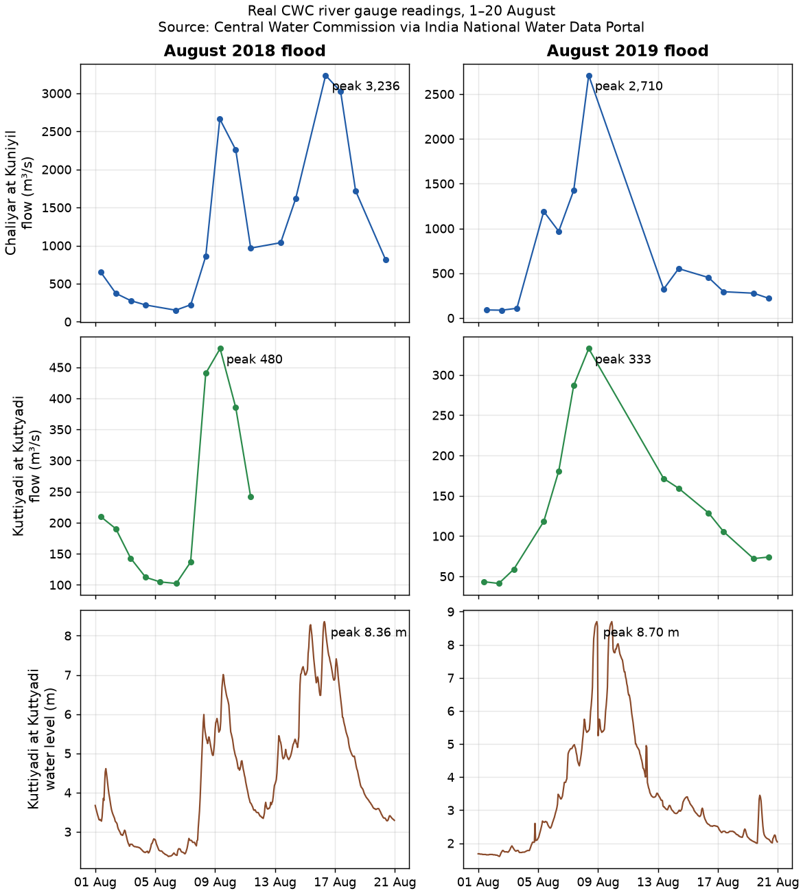
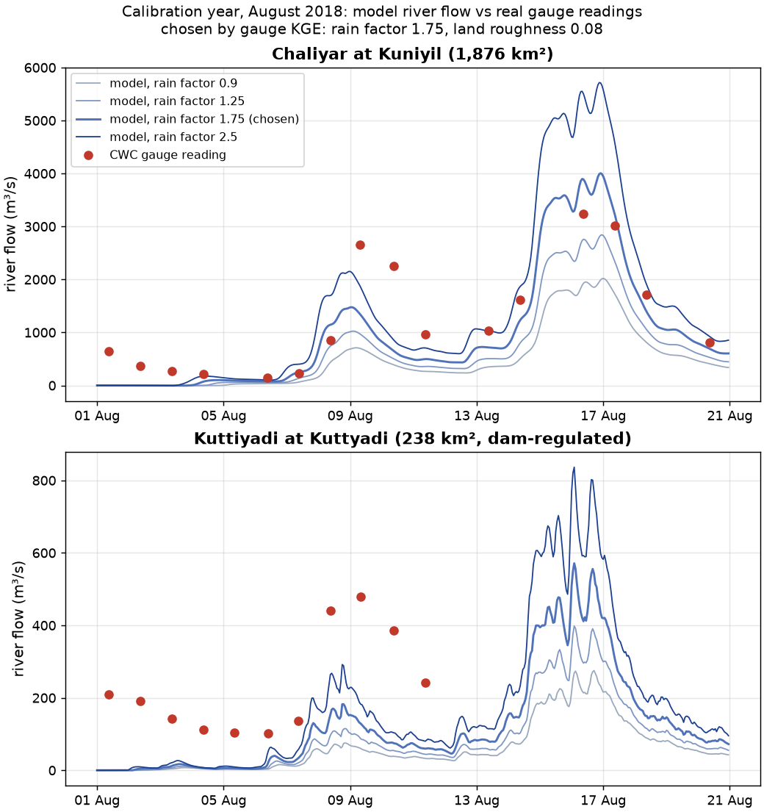
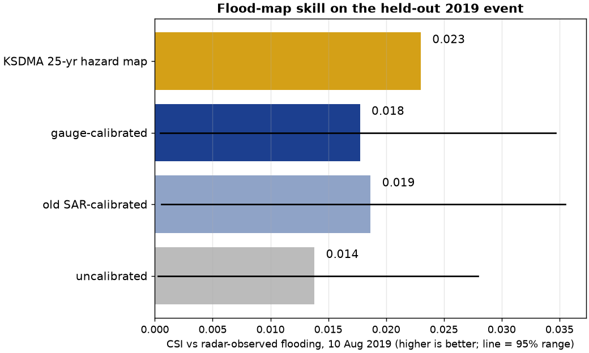

# Testing the flood model against real river gauges

The flood maps were the weakest part of EARTHSIM-Ω: the solver scored a CSI of 0.019 against radar-observed
flooding in August 2019, below the official KSDMA hazard map (0.023). This test asks a simpler question first.
Does the model put the right amount of water down the rivers at the right time? Real Central Water Commission
(CWC) gauge readings for the Chaliyar and Kuttiyadi rivers give the answer.

## What we found, in short

- **Real gauge data exists for both floods.** CWC daily discharge and hourly water levels for August 2018 and
  August 2019 are public on the India National Water Data Portal. Details and links are in
  [`CWC_GAUGE_DATA.md`](CWC_GAUGE_DATA.md).
- **The model's timing is good, but it had far too little water.** In August 2018 the uncalibrated model carried
  only 29% of the Chaliyar's measured volume at Kuniyil (bias −71%). Its flow still tracked the day-to-day ups and
  downs (correlation 0.89).
- **Calibrating on 2018 gauges improved river flow in 2019, a year it never saw.** The mean gauge score (KGE,
  where 1 is perfect) across the two calibration gauges rose from 0.21 (uncalibrated) and 0.32 (old radar-based
  calibration) to 0.52. On a third gauge never used for tuning, Thottathinkadavu, it rose from −0.22 and −0.18 to
  0.09.
- **But it overshoots the 2019 peaks, and the flood map did not improve.** Peak flow came out 1.6× the measured
  value at Kuniyil and 2× at Kuttyadi. Flood-map CSI on 10 Aug 2019 was 0.018, against 0.019 for the old setting.
  The KSDMA map still scores best (0.023).



## The gauges

| Gauge (river) | Catchment, CWC | Catchment, model | Data used |
| --- | --- | --- | --- |
| Kuniyil (Chaliyar) | 1,876 km² | 1,911 km² (+1.9%) | daily discharge 2018, 2019 |
| Kuttyadi (Kuttiyadi) | 238 km² | 237.9 km² (0.0%) | daily discharge 2018, 2019; hourly level |
| Thottathinkadavu (Iruvazhinjipuzha, Chaliyar tributary) | not listed | 164 km² | 2019 only, test gauge |

Each gauge was placed on the model's river network by finding the cell within 3 km whose upstream area matches
CWC's published catchment, accepted only within ±20%. Both main gauges matched about 3 km from their listed
coordinates, at the edge of that search radius.

Two cautions about the data:
- **Kuttyadi is dam-regulated.** Peruvannamuzhi Dam sits about 4 km upstream and controls 46% of the gauge's
  catchment, and the 225 MW Kakkayam power house releases its tail water into the river. The model knows nothing
  about dams, so some of the mismatch here is reservoir operation, not model error.
- **Some readings are missing or inconsistent.** Kuttyadi's daily discharge stops on 11 Aug 2018, so it misses
  that river's main peak on 16 Aug (the hourly water level does record it). Thottathinkadavu's published 2019
  water levels mix values near 5 m with readings near 30 m on 9 Aug and one of 129.6 m, which looks like a datum
  or recording error. That water-level series is reported but not trusted. Discharge readings of zero in the
  middle of the monsoon were treated as missing, a rule added to the protocol before any scoring.



## How the test was kept honest

The protocol ([`configs/experiments/gauge_validation.yaml`](../configs/experiments/gauge_validation.yaml)) was
committed to git before any gauge-scored run. It fixed the parameter grid, the score and the tie-break rule.
August 2018 was used for tuning only. August 2019 was scored once, at the end, for three settings decided in
advance: the gauge-selected one, the old radar-selected one, and the uncalibrated prior.

The solver is the same 240 m local-inertial model used before. A new hook counts the water crossing the boundary
of each gauge's catchment every time step, which gives river flow in m³/s. A unit test on a small synthetic valley
checks that this flow accounting closes the water balance to within 0.1%. Every run conserved mass to about 1e-15.

## Calibration year, August 2018

Eight settings were run: four rain factors (0.9, 1.25, 1.75, 2.5) × two land roughness values (0.08, 0.16).

| Rain factor | Kuniyil KGE | Kuniyil volume bias | Kuttyadi KGE | Kuttyadi volume bias |
| --- | --- | --- | --- | --- |
| 0.7 (prior) | 0.09 | −71% | −0.29 | −94% |
| 0.9 | 0.23 | −62% | −0.24 | −92% |
| 1.25 | 0.47 | −47% | −0.15 | −87% |
| **1.75 (chosen)** | **0.71** | **−24%** | **−0.02** | **−81%** |
| 2.5 | 0.44 | +8% | 0.19 | −70% |

Values shown are for roughness 0.08. The chosen setting has the highest mean KGE across both gauges (0.347).
A flood-depth threshold of 2.0 m was then chosen on the 14 Aug 2018 radar map (CSI 0.020). It is the top of the
grid, and CSI rose steadily with the threshold. Both point to the model flooding too much land.



The plot shows two problems a single number hides:
- The model starts on 1 August with dry rivers. The gauges were already carrying 100–650 m³/s of July monsoon
  flow, so the early weeks are always too low. The model has no baseflow or initial soil wetness.
- It under-predicts the 9 Aug peak and over-predicts the 16–17 Aug peak. The ERA5 reanalysis rain puts water
  on the wrong days, and no single scaling factor can fix timing.

## Held-out year, August 2019

| Setting | Kuniyil KGE | Kuttyadi KGE | Thottathinkadavu KGE | Flood-map CSI (95% range) |
| --- | --- | --- | --- | --- |
| Uncalibrated (0.7, 0.08) | 0.26 | 0.15 | −0.22 | 0.014 (0.000–0.028) |
| Old radar-calibrated (0.9, 0.16) | 0.36 | 0.28 | −0.18 | 0.019 (0.001–0.036) |
| **Gauge-calibrated (1.75, 0.08)** | **0.34** | **0.69** | **0.09** | **0.018 (0.000–0.035)** |
| KSDMA 25-yr hazard map | | | | 0.023 |

More detail for the gauge-calibrated setting:
- Kuttyadi: volume bias −5%, correlation 0.80, NSE 0.45, hourly water-level correlation 0.83. The peak came
  7 h late and was 658 m³/s against 333 measured.
- Kuniyil: volume bias +57%, peak 4,247 against 2,710 m³/s, 13 h late.

The 2018 factor overcompensates in 2019. That means the reanalysis rain bias changes from year to year, so a fixed
rain factor is not a transferable fix.



## Why the flood map did not move

The 95% ranges for all three settings overlap almost completely, so this test cannot tell them apart. The radar
saw only 0.28 km² of flooding in the scored area, while every setting predicted 13–18 km². With so little
observed water, CSI is dominated by false alarms. Some of those are real flooding under trees and roofs that radar
cannot see; some are the model flooding too much. Getting the river volume right does not shrink the flooded area
by itself. Doing that needs a bare-earth DEM, channel geometry and infiltration.

## What would improve this next

1. Start each run from observed July flow (or a spin-up period) instead of dry rivers.
2. Replace uniform ERA5 rain with IMD gridded or station rain, so storms land on the right days.
3. Add Peruvannamuzhi reservoir releases, or score only unregulated gauges.
4. Fix the flooded-area excess with a bare-earth DEM and channel bathymetry, then re-test against radar.

## Reproduce

```bash
python -m earthsim.gauges extract      # CWC readings for the gauges, Aug 2018 and Aug 2019
python -m earthsim.gauges snap         # place gauges on the model river network
scripts/run_gauge_grid.sh              # 2018 grid + prior, 2019 baselines (about 1 h on 8 CPUs)
python -m earthsim.gauges select       # pre-registered choice on 2018 only
python -m earthsim.gauges test         # one-shot held-out scoring on 2019
python scripts/gauge_figures.py calib && python scripts/gauge_figures.py test
```

Results are in `experiments/results/gauges/` (`gauge_selection.json`, `gauge_test_2019.json`,
`gauge_snapping.json`, and the extracted observations as CSV).
